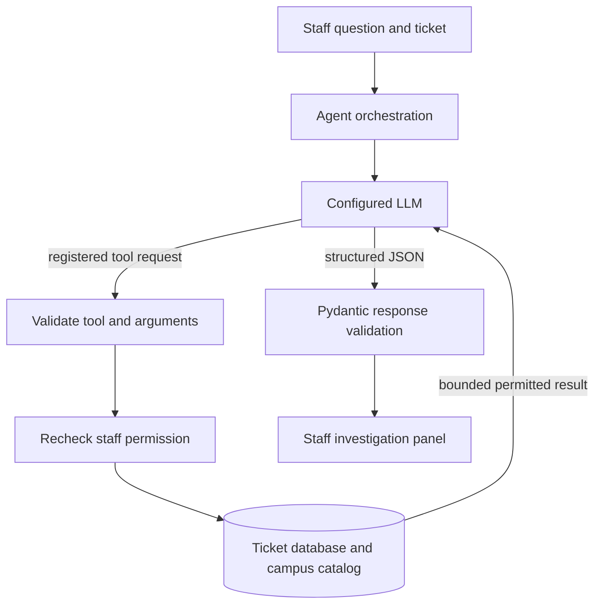

# ResolveAI (backend + Streamlit app)

The top-bar **Dark mode** switch changes the UI palette across the app. Typography
keeps the Fraunces display and DM Sans interface pairing; category, status, and
priority colors are adjusted for readable contrast in dark mode. Light mode remains
the default.

The landing page uses a dark campus-map hero with softly drifting service lights. As visitors scroll, overview sections roll upward in layered sheets. The effects are responsive and respect reduced-motion preferences.

## AKGEC Campus Intelligence (current database schema v16)

Staff ticket removal is soft and auditable. The record, comments, event history,
and attachments are retained; the ticket leaves active work and its student sees
the staff member's reason on the Track a ticket page and secure tracking lookup.
This is an in-app notice shown when the student next checks the ticket.

Each issued ticket stores a UTC resolution target based on its priority SLA.
Students see the target on their ticket and secure lookup. Staff may change it
while work is active; moving the target later requires a reason that appears in
the student-visible timeline and the audit log.

The staff-only **Campus Intelligence** page maps catalogued AKGEC places and
summarizes actual ticket records using date, location type, category, priority,
status, and service-team filters. The recurring-issues view uses an explicit
threshold of at least three non-withdrawn tickets for the same location and
category. Missing and uncertain coordinates remain visible in the catalog but
are not plotted. Coordinates are Google Maps pins or user-provided points, not
field-surveyed building footprints.

SQLite schema v8 adds `campus_locations`, `academic_departments`, and
`academic_department_aliases`, plus nullable `tickets.location_id`. Existing
free-text ticket locations are preserved; migration links only exact
case-insensitive name matches. It keeps Google Maps links separate from official
AKGEC source links. Existing `tickets.department` remains the
operational service team and is separate from the academic department catalog.
The migration is idempotent and does not reset ticket data.

The location catalog includes the Central Library gate point from AKGEC's
2021 GPS-tagged photo, departmental libraries with published block/floor
details, and named CSE, IT, Civil, and ECE laboratories from AKGEC's official
geotagged records. Labs without independent coordinates appear in the
hierarchy and report-location search; they are not drawn as co-located map pins.

The page includes the staff-only ResolveAI Campus Intelligence Agent. The
underlying configured LLM is the language model provider; the agent is the
application orchestration around that model, registered database tools,
authorization checks, bounded conversation context, and validated responses.
No model is trained by this project.

## Campus Intelligence agent

The agent receives a staff question and ticket reference, calls the configured
OpenAI-compatible model, and executes only the six registered read tools in
`agent_service.py`: ticket snapshot, related reports, permitted ticket history,
campus location search, filtered campus issue counts, and related open issues.
Every call is re-authorized against the database, arguments are validated on
the server, results are bounded, and withdrawn/sample records are excluded from
the tools that summarize or compare reports. There are no write/action tools.
The response is validated as a Pydantic model and citations are checked against
records returned during the run.

Follow-up context is held only in the authenticated user's Streamlit session,
bounded by `AGENT_MAX_HISTORY_MESSAGES`; starting a fresh investigation or
signing out clears it. It is not durable memory. Complaint text, notes, and
tool results are treated as untrusted content. Internal comments are excluded.
Read-only answers still require staff judgment and do not establish that a
repair happened.

Agent limits are configured with `AGENT_MAX_TURNS`, `AGENT_MAX_TOOL_CALLS`,
`AGENT_MAX_TOOL_CALLS_PER_TURN`, `AGENT_MAX_HISTORY_MESSAGES`, and
`AGENT_TIMEOUT_SECONDS`. Code caps these to 8 turns, 20 total calls, 5 calls
per turn, 20 history messages, and 120 seconds respectively.

The report form provides ten distinct example descriptions. Staff can load ten
labelled sample tickets together from the empty queue; sample records are
excluded from Campus Intelligence counts by default and can be included for a
demo using the explicit filter.

## Run locally
    python -m venv .venv && source .venv/bin/activate      # Windows: .venv\Scripts\activate
    pip install -r requirements.txt
    cp .env.example .env            # paste your Groq key as LLM_API_KEY, set STAFF_EMAIL and STAFF_PASSWORD (first staff account)
    python check_ai.py              # want "Mode: llm". If "fallback", read the WARNING line.
    python -m pytest -q             # tests use mocks; no key or internet needed
    streamlit run app.py

The automated suite also exercises the agent with mocked model responses; a
real investigation requires an active `LLM_API_KEY` and a provider/model that
supports OpenAI-compatible tool calls.

For quick demo accounts, set `DEMO_MODE=1` in `.env` and restart the app. The Home sign-in panel then offers one-touch student, staff and occupation-specific worker access and shows the selected fictional email plus shared password (`DemoPass123`). Keep demo mode off on any public deployment.

## Deploy (Streamlit Community Cloud)
Push to GitHub (.env and *.db are git-ignored). In the app's Settings > Secrets add:
    LLM_API_KEY = "..."   STAFF_EMAIL = "..."   STAFF_PASSWORD = "..."   LLM_MODEL = "..."
Note: Community Cloud storage is not guaranteed to persist, so seed demo data before presenting.

## Production files
Dockerfile, docker-compose.yml (app + nightly backup), .github/workflows/ci.yml, requirements.lock.txt (pinned), healthcheck.py, backup.py. See DEPLOYMENT.md for the proxy setup and an honest list of what is NOT production-grade yet.

## Evaluation (reproducible)
    python eval_duplicates.py     # duplicate matcher on 48 labelled pairs
    python eval_ai.py             # complaint analysis on 32 labelled complaints (uses the real LLM if LLM_API_KEY is set)
Results and caveats: evaluation/RESULTS.md. Demo plan: DEMO_SCRIPT.md. Hosting: DEPLOYMENT.md.

## Modules
app.py UI | workflow.py orchestration | ai_service.py LLM + fallback | voice_service.py speech transcription
duplicate_service.py RapidFuzz | ticket_service.py verified writes | database.py SQLite | schemas.py validation | analytics.py chart data

## Voice complaints
The Report an issue page uses Streamlit's browser microphone widget, with a WAV upload fallback. Audio stays in session memory until transcription, is validated as WAV for file size and duration, and is sent only after the student selects **Transcribe audio**. ResolveAI does not save the raw recording. The transcript fills the normal complaint text box; the student reviews and edits it before running AI review and submitting. Voice uses a separate speech-to-text service, so it does not change the existing complaint classification pipeline.

The default speech endpoint is Groq's OpenAI-compatible API using `whisper-large-v3-turbo` and English. Speech transcription reuses `LLM_API_KEY` when it is a Groq key; set `SPEECH_API_KEY` for a separate key. Set `SPEECH_BASE_URL` if using another OpenAI-compatible transcription provider. `SPEECH_MODEL`, `SPEECH_TIMEOUT_SECONDS`, `SPEECH_MAX_AUDIO_MB`, `SPEECH_MAX_DURATION_SECONDS`, and `SPEECH_LANGUAGE` are also configurable in `.env`. The bundled audio limit is 10 MB and 120 seconds; Streamlit's upload limit is 12 MB. Transcription is rate-limited per student using the existing per-hour analysis limit.

### Windows PowerShell
    py -m venv .venv
    .\.venv\Scripts\Activate.ps1
    python -m pip install -r requirements.txt
    if (-not (Test-Path .env)) { Copy-Item .env.example .env }
    # Edit .env and add LLM_API_KEY (or SPEECH_API_KEY) for transcription.
    streamlit run app.py

Manual voice check: sign in as a student; open Report an issue; allow microphone access; record and stop; confirm the duration appears; transcribe; edit the populated complaint; run AI review; inspect duplicate suggestions; submit only after choosing a submit action. Also check empty/very short audio, the size or duration limit, a temporary network failure, and that **Discard recording** clears the voice draft. No API key is required by the automated tests.

## Database system
ResolveAI uses SQLite, a relational database stored in one local file (`DB_PATH`, default `resolveai.db`). It needs no separate database server. The tables store users and password hashes, tickets, ticket comments and audit events, login sessions, rate-limit events, failed guest lookup attempts, attachment metadata, and schema versions. Photo bytes live as private files in `UPLOAD_DIR`; SQLite stores their names and metadata.

Connections enable foreign-key checks and a 10-second busy timeout. The database is switched to WAL (write-ahead logging) mode at initialization; this lets readers continue while a write is in progress. Writes use explicit `BEGIN IMMEDIATE` transactions, and ticket operations read saved records back to verify changes. Schema upgrades are versioned; version 5 added ticket query indexes, version 6 added an auditable Withdrawn status, version 10 added ticket deadlines and auditable extensions, version 11 added reporter anonymity, version 12 added the life-safety flag, version 13 added occupation-scoped worker accounts, version 14 added worker phone contacts, version 15 indexes worker recipient lookups for safety notifications, and version 16 adds worker-account deactivation while preserving ticket/audit history. Existing ticket records and account IDs are preserved by versioned migrations. Run `python backup.py --dir backups --keep 14` for an online SQLite backup; the backup is checked with `PRAGMA integrity_check` before it is published.

Students can submit anonymously to campus staff. The database retains the private reporter account link so only that student can track, comment on and manage the ticket. Staff timelines mask the student's account name for anonymous tickets, and staff are prompted to reply through the ticket. Anonymous mode cannot prevent identifying details in the complaint text, selected location or attached images, so the report form calls this out before submission.

## Emergency contacts

The **Emergency** page is available in the navigation without sign-in and is also included in student, worker and staff navigation. It provides tap-to-call links for 112, police, fire, ambulance and the Uttar Pradesh women’s helpline. The page identifies the AKGEC general college contact separately and explicitly says it is not a verified 24-hour emergency line. ResolveAI does not contact responders or share the student's location automatically. If someone is in immediate danger, call 112 directly.

Explicit reports mentioning hazards such as fire, smoke, gas leaks, exposed/live wires, electric shock, collapse, carbon monoxide or chemical spills are deterministically flagged, marked for review, routed to **Campus Safety & Emergency Response**, and assigned the critical response target (`SLA_CRITICAL_MINUTES`, default 30). The staff workspace's Critical safety queue refreshes every 30 seconds while open. Optional SMTP emails are sent to non-demo safety responders and all-department staff admins. Configure `ALERT_SMTP_HOST`, `ALERT_SMTP_PORT`, `ALERT_SMTP_USERNAME`, `ALERT_SMTP_PASSWORD`, and `ALERT_EMAIL_FROM`; SMTP must be configured for device email delivery. To add responders, create worker accounts with an occupation, for example `python create_user.py worker "Campus Safety Responder" responder@college.edu --occupation "Campus Safety & Emergency Response"`. Existing teams (Electrical Maintenance, IT/Network Support, Plumbing, Hostel Maintenance, Equipment/Lab Support, General Administration) can be assigned the same way. This ticket alert is not a substitute for calling campus emergency services.

Workers are separate from staff admins. A staff admin creates and manages worker accounts in Staff workspace > System or with `python create_user.py worker "Name" email --occupation "Electrical Maintenance"`. Admins can update a worker's email, occupation, phone or password, or remove the login. Removal disables sessions, clears the SMS contact, releases active tasks, and preserves the account identity in existing ticket history. Changing occupation releases active assignments. Worker login asks for the assigned occupation; it must match the account. Workers see only their team's tasks, can claim unassigned tasks, add student-visible updates and repair evidence, and mark work complete. The worker workspace includes the Campus Intelligence location map with Google Maps directions and no cross-team report counts. Demo mode provides one occupation-specific login for each worker team; see DEPLOYMENT.md for usernames. The shared password is `DemoPass123`.

Critical hazard SMS notifications use Twilio when configured with `TWILIO_ACCOUNT_SID`, `TWILIO_AUTH_TOKEN`, and either `TWILIO_MESSAGING_SERVICE_SID` or `TWILIO_FROM_PHONE`. Worker phone numbers are stored in the users table, default to `DEFAULT_WORKER_PHONE`, and can be changed by an admin in Staff workspace > System. SMS is sent only to non-demo Campus Safety workers with a number. It includes the ticket reference and location but excludes reporter identity and the complaint text. Demo workers never receive real alerts.

Students can withdraw their own report only within five minutes of submission, while it is open and unassigned. A reason is required. Withdrawal keeps the ticket, photos, comments and audit history; it does not restore the daily report limit. The third withdrawal within a rolling seven-day window is flagged for staff review. The flag requests review and does not impose an automatic penalty.

SQLite fits a single-server demo or small deployment. It still allows only one writer at a time and does not replicate across app instances. Keep the database and photo directory on persistent storage and copy backups off the host. For multiple app servers, higher write concurrency, or high availability, plan a move to PostgreSQL and shared object storage.

## Known limitations (prototype)
Accounts: no email verification or emailed reset links (staff issue one-time reset codes instead); the session token is carried in the page address, so do not share it; there is no managed database. Guest ticket lookup is rate-limited per session only.
Duplicate threshold (DUP_THRESHOLD=45) was tuned on only 48 hand-written pairs. Groq model IDs change; update LLM_MODEL if the API rejects it.
